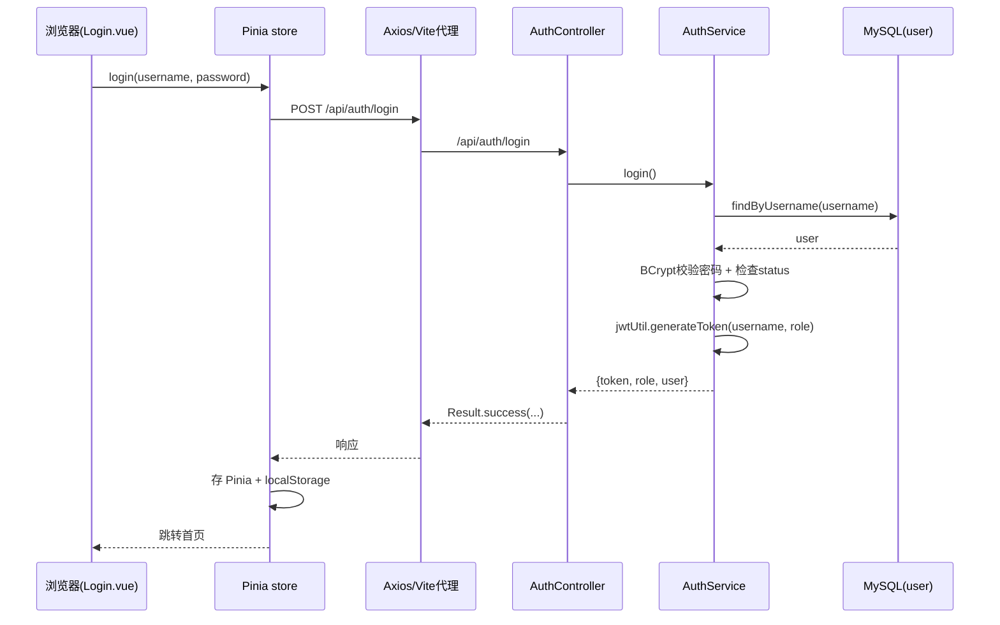
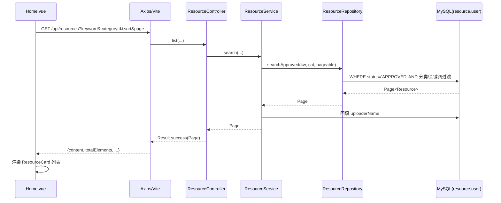
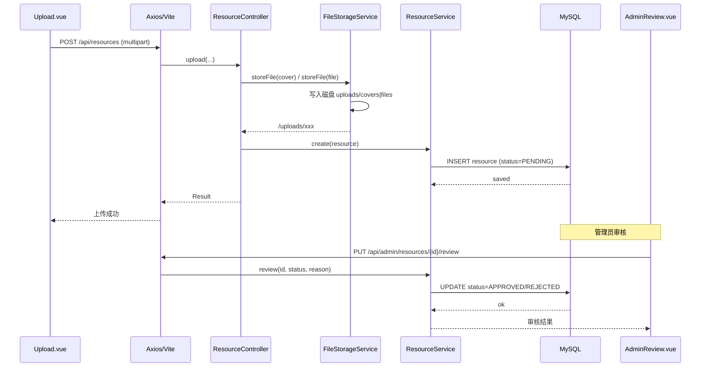
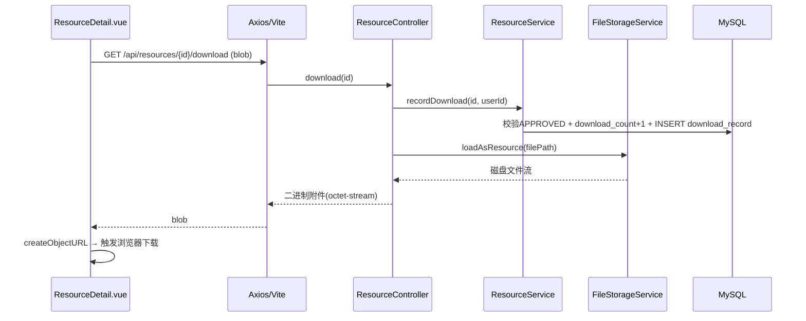
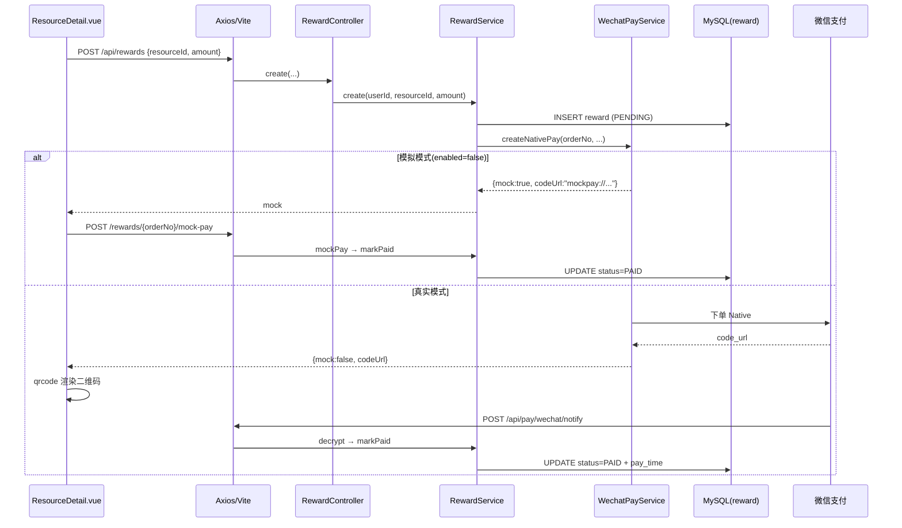

# 资源共享平台 —— 功能链路文档

> 每条链路均按 **前端 → Vite 代理 → 后端 → 数据库** 顺序展开，标注具体文件与关键逻辑。
> 相关文件路径：后端在 `backend/src/main/java/com/resourceshare/`，前端在 `frontend/src/`，均省略前缀。

---

## 0. 总体架构与通用请求生命周期

```
浏览器 (Vue 3, http://localhost:3000)
   │  页面/组件 → Pinia store → utils/axios
   ▼
Vite Dev Server  (proxy)
   │  /api/*  → http://localhost:9090/api/*
   │  /uploads/* → http://localhost:9090/uploads/*
   ▼
Spring Boot (Tomcat, http://localhost:9090)
   │  JwtAuthenticationFilter（解析 token → 塞入 SecurityContext）
   │  SecurityConfig（按路径/角色放行或拦截）
   ▼
Controller → Service → Repository(JPA) → MySQL
   │  静态文件 /uploads/** → 本地磁盘 uploads/ 目录
```

### 通用约定

| 项 | 约定 |
| --- | --- |
| 统一返回体 | `{ code: "200" \| "500", msg, data }`，业务错误也返回 HTTP 200 + `code:"500"`（`common/Result.java`） |
| 异常兜底 | 业务里 `throw new CustomException(msg)`，由 `exception/GlobalExceptionHandler` 转成 `Result.error` |
| 分页结构 | 直接返回 Spring Data `Page`：`{ content, totalElements, totalPages, number }` |
| 鉴权方式 | 无状态 JWT，请求头 `Authorization: Bearer <token>` |
| 前端拦截器 | `utils/axios.ts`：请求前自动加 token；响应时把 `code!=="200"` 转成 reject；401 时登出跳登录页 |

---

## 1. 登录链路

**目的**：校验账号密码，签发 JWT，前端持久化登录态。

| 环节 | 位置 | 动作 |
| --- | --- | --- |
| 前端发起 | `pages/Login.vue:handleLogin` | 收集 username/password → `userStore.login()` |
| 调用封装 | `store/user.ts:login` | `axios.post('/auth/login', {username, password})` |
| 代理 | Vite | `/api/auth/login` → `http://localhost:9090/api/auth/login` |
| 控制器 | `controller/AuthController.java` | `login()` → `AuthService.login()` |
| 业务 | `service/AuthService.java` | ① `userRepository.findByUsername` 查用户 ② `BCryptPasswordEncoder.matches` 校验密码 ③ 检查 `status` 是否为 `DISABLED` ④ `JwtUtil.generateToken(username, role)` 生成 token |
| 数据库 | `user` 表 | 读 `username / password / role / status` |
| 返回 | `util/JwtUtil.java` | 返回 `{ token, role, user }`（token 内 `subject=username`，claim `role=角色`） |
| 前端落库 | `store/user.ts` | token/user 存入 Pinia + `localStorage`，后续请求自动带 token |



---

## 2. 鉴权（JWT）链路 —— 后续每个受保护请求的必经步骤

| 环节 | 位置 | 动作 |
| --- | --- | --- |
| 前端 | `utils/axios.ts:request拦截器` | 若 store 有 token，自动加 `Authorization: Bearer <token>` |
| 过滤器 | `config/JwtAuthenticationFilter.java` | 解析 header → `JwtUtil.isTokenValid` 校验签名/过期 → 把 `username` + `ROLE_<role>` 放入 `SecurityContextHolder` |
| 授权 | `config/SecurityConfig.java` | 按路径授权：`/api/auth/**`、`/uploads/**`、`GET /api/resources`、`GET /api/categories` 等放行；`/api/admin/**` 需 `ADMIN` 角色；其余 `authenticated()` |
| 取当前用户 | `service/CurrentUserService.java` | 从 `SecurityContextHolder` 取 username → `userRepository.findByUsername` 查库，返回完整 User / userId / isAdmin |

> 权限矩阵（`SecurityConfig.java:41-51`）：
> - 公开：`/api/auth/**`、`/uploads/**`、`/swagger-ui/**`、`GET /api/categories`、`GET /api/resources`、`GET /api/users/statistics`、`/api/pay/wechat/notify`
> - 管理员：`/api/admin/**` → `hasRole("ADMIN")`
> - 其余：需登录

---

## 3. 资源检索链路（首页列表 / 搜索 / 分类 / 排序）

| 环节 | 位置 | 动作 |
| --- | --- | --- |
| 前端发起 | `pages/Home.vue:loadResources` | `axios.get('/resources', { params: { page, size, keyword, categoryId, sort } })` |
| 分类加载 | `pages/Home.vue:loadCategories` | `axios.get('/categories')` 拉分类做筛选按钮 |
| 代理 | Vite | `/api/resources?...` → 后端 |
| 控制器 | `controller/ResourceController.java:list` | 接收 5 个查询参数 |
| 业务 | `service/ResourceService.java:search` | `resolveSort` 把 `sort`（newest/downloads/views/likes）映射为 `Sort`，调用仓库 |
| 数据访问 | `repository/ResourceRepository.java:searchApproved` | JPQL 查询：**仅 `status='APPROVED'`**，`categoryId` 可选过滤，`keyword` 对 `title/description` 做 `LIKE '%kw%'`（忽略大小写） |
| 数据库 | `resource` 表 | 分页查询；再 `user` 表回填 `uploaderName` |
| 返回 | — | `Page<Resource>`，前端取 `content` 渲染 `ResourceCard` |



---

## 4. 资源详情 + 浏览计数链路

| 环节 | 位置 | 动作 |
| --- | --- | --- |
| 前端发起 | `pages/ResourceDetail.vue:loadDetail` | `axios.get('/resources/{id}')` |
| 控制器 | `controller/ResourceController.java:detail` | → `ResourceService.detail()` |
| 业务 | `service/ResourceService.java:detail` | ① 查资源 ② 若非 `APPROVED` 抛「资源不存在或未通过审核」③ `viewCount + 1` 并保存 |
| 数据库 | `resource` 表 | `UPDATE resource SET view_count = view_count + 1` |
| 附带请求 | `ResourceDetail.vue` | 并行拉分类名、登录态下再查 `GET /likes/check/{id}`、`GET /favorites/check/{id}` 决定按钮高亮 |

---

## 5. 上传资源链路（含文件落盘）

| 环节 | 位置 | 动作 |
| --- | --- | --- |
| 前端发起 | `pages/Upload.vue:submit` | 组装 `FormData`（title/description/categoryId/points/cover/file），`Content-Type: multipart/form-data`，`axios.post('/resources', formData)` |
| 控制器 | `controller/ResourceController.java:upload` | 取 `currentUserService.getCurrentUserId()`，接收 `MultipartFile cover / file` |
| 文件存储 | `util/FileStorageService.java:storeFile` | 生成 `UUID.ext`，写入磁盘 `uploads/covers/` 或 `uploads/files/`，返回 `/uploads/{sub}/{uuid.ext}` |
| 业务 | `service/ResourceService.java:create` | 组装实体，`status = "PENDING"`（待审核），保存 |
| 数据库 | `resource` 表 | INSERT 一条待审核资源 |
| 返回 | 前端 | 提示「上传成功，等待审核」，1.2s 后跳个人中心 |

> 文件大小限制：`application.yml` `spring.servlet.multipart.max-file-size: 100MB`。



---

## 6. 审核链路（管理员）

| 环节 | 位置 | 动作 |
| --- | --- | --- |
| 前端发起 | `pages/admin/AdminReview.vue` | 列表 `GET /admin/resources?status=...`；通过 `PUT /admin/resources/{id}/review` body `{status:"APPROVED"}`；驳回 `{status:"REJECTED", reason}` |
| 授权 | `SecurityConfig` | `/api/admin/**` 需 `ADMIN` 角色 |
| 控制器 | `controller/AdminController.java:review` | → `ResourceService.review()` |
| 业务 | `service/ResourceService.java:review` | `APPROVED` → 置通过、清空驳回原因；`REJECTED` → 置驳回 + 记录原因 |
| 数据库 | `resource` 表 | UPDATE `status` / `reject_reason` |
| 结果 | 前端 | 通过后资源进入首页检索结果；驳回后上传者在个人中心可见驳回原因 |

---

## 7. 下载链路

| 环节 | 位置 | 动作 |
| --- | --- | --- |
| 前端发起 | `pages/ResourceDetail.vue:download` | `axios.get('/resources/{id}/download', { responseType: 'blob' })` |
| 控制器 | `controller/ResourceController.java:download` | → `ResourceService.recordDownload()` |
| 业务 | `service/ResourceService.java:recordDownload` | ① 校验 `APPROVED` ② 校验 `filePath` 非空（示例数据无文件则提示）③ `downloadCount + 1` ④ INSERT `DownloadRecord` |
| 文件读取 | `util/FileStorageService.java:loadAsResource` | 把 `/uploads/...` 相对路径映射到本地磁盘文件 |
| 数据库 | `resource` + `download_record` | 更新下载数 + 写下载记录 |
| 返回 | 前端 | 以 `application/octet-stream` 附件流返回；前端 `URL.createObjectURL(blob)` 触发浏览器下载 |



---

## 8. 点赞 / 收藏（toggle）链路

> 两者逻辑对称，表不同、计数字段不同。以点赞为例。

| 环节 | 位置 | 动作 |
| --- | --- | --- |
| 前端发起 | `ResourceDetail.vue:toggleLike` | `axios.post('/likes/{id}/toggle')` |
| 控制器 | `controller/LikeController.java:toggle` | → `LikeService.toggle(currentUserId, resourceId)` |
| 业务 | `service/LikeService.java:toggle` | 查 `resource_like` 是否存在该 (user,resource) 组合：存在→删除、`likeCount-1`；不存在→新增、`likeCount+1`；返回 `{ liked, likeCount }` |
| 数据库 | `resource_like` 表（唯一键 `uk_user_resource`）+ `resource` 表 | 删除/插入点赞记录，更新 `like_count` |
| 收藏对照 | `controller/FavoriteController.java` + `service/FavoriteService.java` | 表 `favorite`，字段 `favorite_count`；另有 `GET /favorites` 我的收藏列表 |

---

## 9. 评论链路

| 操作 | 前端 | 后端 | 数据库 |
| --- | --- | --- | --- |
| 列表 | `GET /resources/{id}/comments?page&size` | `CommentController.list` → `CommentService.listByResource` → `commentRepository.findByResourceId`（倒序分页） | 读 `comment` 表，回填 `username` |
| 发表 | `POST /resources/{id}/comments` body `{content,parentId}` | `CommentController.add` → `CommentService.add`（校验内容非空 → 插入 → 重算评论数） | INSERT `comment`，UPDATE `resource.comment_count` |
| 删除 | `DELETE /comments/{id}` | `CommentController.delete` → 校验「本人或管理员」→ 删除 → 重算 | DELETE `comment`，UPDATE `resource.comment_count` |

---

## 10. 打赏 / 微信支付链路

**阶段一：创建订单**

| 环节 | 位置 | 动作 |
| --- | --- | --- |
| 前端发起 | `ResourceDetail.vue:submitReward` | `axios.post('/rewards', { resourceId, amount })` |
| 控制器 | `controller/RewardController.java:create` | → `RewardService.create()` |
| 业务 | `service/RewardService.java:create` | 生成 `orderNo`，INSERT `reward`（status=`PENDING`），调用 `WechatPayService.createNativePay()` |
| 支付 | `service/WechatPayService.java` | **模拟模式**（`app.wechat.enabled=false`）：返回 `{mock:true, codeUrl:"mockpay://..."}`；**真实模式**：签名调用微信 `v3/pay/transactions/native`，返回 `code_url` |
| 数据库 | `reward` 表 | INSERT 待支付订单 |

**阶段二：支付完成**

| 模式 | 前端 | 后端 | 数据库 |
| --- | --- | --- | --- |
| 模拟 | 显示「模拟支付成功」按钮 → `POST /rewards/{orderNo}/mock-pay` | `RewardController.mockPay` → `RewardService.mockPay` → `markPaid` | UPDATE `reward.status='PAID'` |
| 真实 | 前端用 `qrcode` 库渲染二维码，用户扫码 | 微信异步回调 `POST /api/pay/wechat/notify` → `PayController.wechatNotify` → `WechatPayService.decryptNotify` 解密 → `RewardService.markPaid` | UPDATE `reward.status='PAID'` + `pay_time` |

> 查询：`GET /rewards/mine`（我打赏的）、`GET /rewards/received`（我收到的）。



---

## 11. 注册链路

| 环节 | 位置 | 动作 |
| --- | --- | --- |
| 前端发起 | `pages/Register.vue` | `FormData`（可含头像）→ `axios.post('/auth/register', formData, multipart)` |
| 控制器 | `controller/AuthController.java:register` | 接收表单字段 + `avatar` 文件，头像经 `FileStorageService.storeFile(avatar, "avatars")` 落盘 |
| 业务 | `service/AuthService.java:register` | 校验用户名/密码非空 → 查重用户名/手机号 → BCrypt 加密 → `role="USER"`、`status="ACTIVE"` → 保存 |
| 数据库 | `user` 表 | INSERT 新用户 |

---

## 12. 个人中心链路（`pages/UserCenter.vue`）

| 功能 | 接口 | 后端 | 数据库 |
| --- | --- | --- | --- |
| 我的上传 | `GET /users/me/resources` | `UserController.myResources` → `ResourceService.myUploads` | 读 `resource`（按 uploaderId） |
| 我的下载 | `GET /users/me/downloads` | `UserController.myDownloads` → 查 `download_record` 再关联 `resource` | 读 `download_record` + `resource` |
| 我的收藏 | `GET /favorites` | `FavoriteController.myFavorites` → `FavoriteService.myFavorites` | 读 `favorite` + `resource` |
| 资料修改 | `PUT /users/me` | `UserController.updateMe` | UPDATE `user` |
| 头像上传 | `POST /users/me/avatar` | `UserController.uploadAvatar` → `storeFile(...,"avatars")` | 磁盘 + UPDATE `user.avatar` |
| 密码修改 | `PUT /users/me/password` | `UserController.updatePassword`（校验旧密码 → BCrypt 加密新密码） | UPDATE `user.password` |

---

## 附：数据表清单（`resources/schema.sql`）

| 表 | 用途 | 关键字段 |
| --- | --- | --- |
| `user` | 用户 | username, password, role(USER/ADMIN), status(ACTIVE/DISABLED), avatar |
| `category` | 分类 | name, parent_id, sort_order |
| `resource` | 资源 | title, cover_image, file_path, status(PENDING/APPROVED/REJECTED), 各计数字段, uploader_id |
| `favorite` | 收藏 | user_id + resource_id（唯一键） |
| `resource_like` | 点赞 | user_id + resource_id（唯一键） |
| `comment` | 评论 | resource_id, user_id, parent_id, content |
| `download_record` | 下载记录 | user_id, resource_id |
| `reward` | 打赏订单 | order_no, amount, status(PENDING/PAID/CLOSED) |
